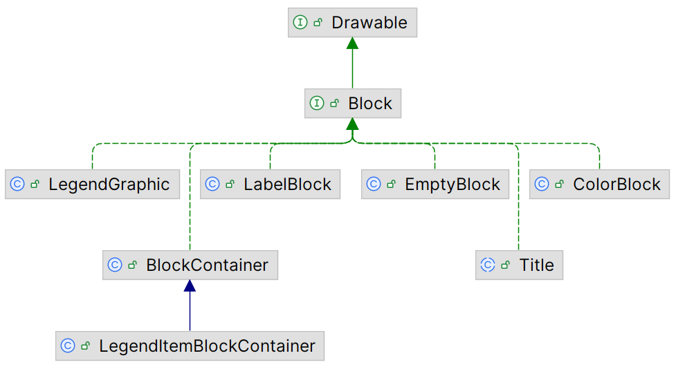
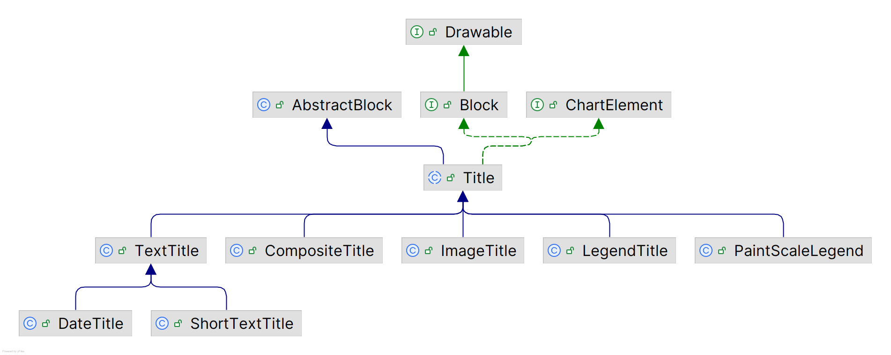
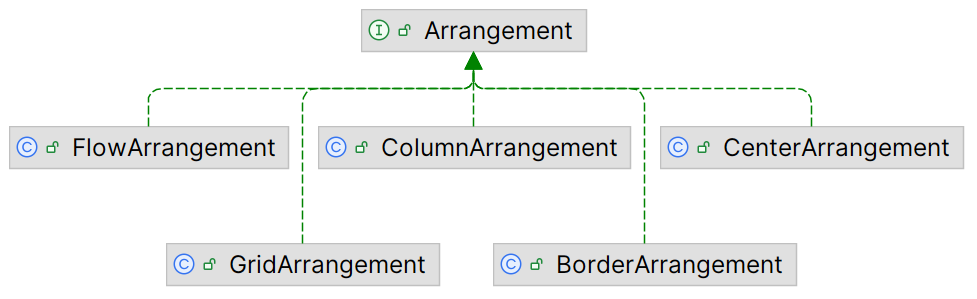

# Block

## 简介

`Block` 指能够在一个矩形区域内绘制自身的对象，具有 `prefSize`，可由 `Arrangement` 进行排版。



- `LegendGraphic`：`LegendTitle` 内部的图形元素
- `BlockContainer`：`Block` 容器，并使用 `Arrangement` 管理 `Block` 位置
- `LegendItemBlockContainer`：用于管理单个 legend-item 的 `Block` 元素
- `LabelBlock` 

### Drawable

```java
public interface Drawable {
    void draw(Graphics2D g2, Rectangle2D area);
}
```

`Drawable` 指能够在指定区域内绘制的对象。

### Block

`Block` 特征：

- 可布局；
- 可在矩形区域绘制自身（`Drawable`）；
- id：提供 id，便于在容器内区分不同 `block`

**arrange**

`arrange` 计算 `Block` 尺寸。

```java
Size2D arrange(Graphics2D g2);
Size2D arrange(Graphics2D g2, RectangleConstraint constraint);
```

- `arrange(Graphics2D g2)`：无外部约束，`Block` 按自身理想尺寸报告大小；
- `arrange(Graphics2D g2, RectangleConstraint constraint)`：在给定约束下计算尺寸。

**bounds**

```java
Rectangle2D getBounds();
void setBounds(Rectangle2D bounds);
```

`bounds` 是 `Block` 在父容器中的实际占据区域，由 `Arrangement` 在布局阶段写入，在绘制阶段读取。

**draw**

```java
Object draw(Graphics2D g2, Rectangle2D area, Object params);
```

## Title



所有标题的抽象基类，封装标题的**通用属性**：

```java
public boolean visible;                          // 1. 标题的可见性
private RectangleEdge position;                  // 2. 标题位置
private HorizontalAlignment horizontalAlignment; // 3. 水平对齐方式
private VerticalAlignment verticalAlignment;     // 4. 垂直对齐方式
```

通用行为：

```java
// 5. 监听器是运行时对象，不应被序列化
private transient EventListenerList listenerList;

// 6. 临时禁用时间通知，典型场景：批量修改属性或克隆，避免触发大量冗余事件
private boolean notify;
```

1. 事件通知
2. 克隆
3. 序列化

具体的绘制逻辑由子类通过覆盖抽象方法 `draw()` 实现。

### TextTitle

`TextTitle` 用于绘制纯文本标题。内容：

- 文本内容：`text`
- 文本外观：`font` 字体，`paint` 颜色，`backgroundPaint` 背景色，`textAlignment` 对齐
- 交互：`toolTipText` 提示文本，`urlText`
- 布局：`content`, `expandToFitSpace`, `maximumLinesToDisplay`

**content**

```java
private TextBlock content;
```

`content` 不是用户配置项，而是 `arrange()` 阶段由 `TextUtils.createTextBlock(...)` 生成的文本布局对象（负责换行、行对齐、计算尺寸），其功能：

- 布局与绘制分离：`arrange` 生成 `content`，`draw` 直接消费 `content`；
- 避免重复测量：一次 `arrange` 后多次 `draw` 可复用。

#### 对齐

`horizontalAlignment` (`Title`) 设置标题矩形块在绘图空间中的对齐方式；

`textAlignment` 设置文本在标题矩形块内部的对齐方式。

## Arrangement



