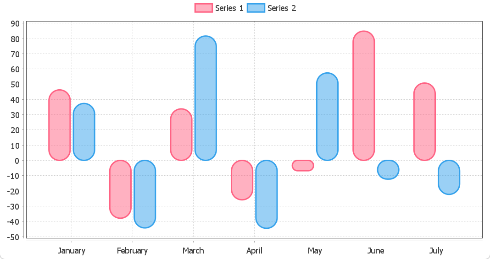

# Bar Charts

## Border Radius

```java
public class BarChartDemo13 {

    private static CategoryBarChart createChart() {
        String[] months = {"January", "February", "March", "April", "May", "June", "July"};
        Random rnd = new Random(42);

        DefaultCategoryDataset<String, String> dataset = new DefaultCategoryDataset<>();
        for (String month : months) {
            dataset.addValue(rnd.nextDouble(201) - 100, "Series 1", month);
            dataset.addValue(rnd.nextDouble(201) - 100, "Series 2", month);
        }

        CategoryBarChart chart = new CategoryBarChart(dataset);
        chart.getLegend().setPosition(RectangleEdge.TOP);
        chart.withDomainGridlinesVisible(true)
                .withRangeGridlinesVisible(true);

        final Color RED = new Color(255, 99, 132);
        final Color BLUE = new Color(54, 162, 235);

        chart.getRenderer()
                .withBarPainter(new RoundedBarPainter(true))
                .withItemMargin(0.05)
                .withShadowVisible(false)
                .withDrawBarOutline(true)
                .withSeriesPaint(0, PaintUtils.withAlpha(RED, 0.5f))
                .withSeriesOutlinePaint(0, RED)
                .withSeriesOutlineStroke(0, new BasicStroke(2f))
                .withSeriesPaint(1, PaintUtils.withAlpha(BLUE, 0.5f))
                .withSeriesOutlinePaint(1, BLUE)
                .withSeriesOutlineStroke(1, new BasicStroke(2f))
                .withDefaultLegendShape(new Rectangle2D.Double(-8, -5, 25, 12));

        return chart;
    }

    static void main() {
        createChart().show();
    }
}
```

