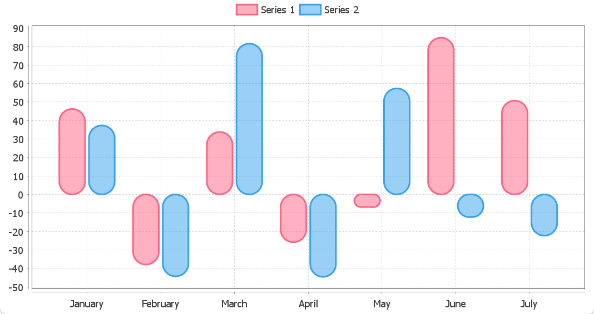
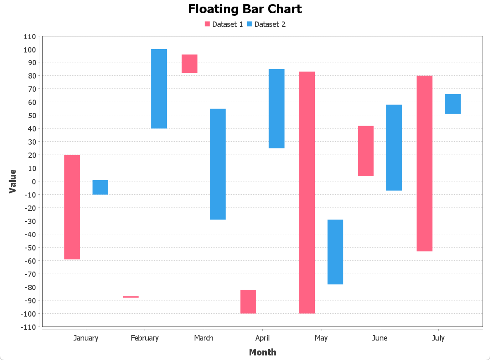
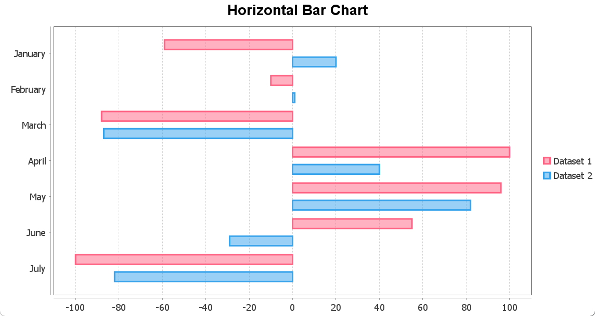
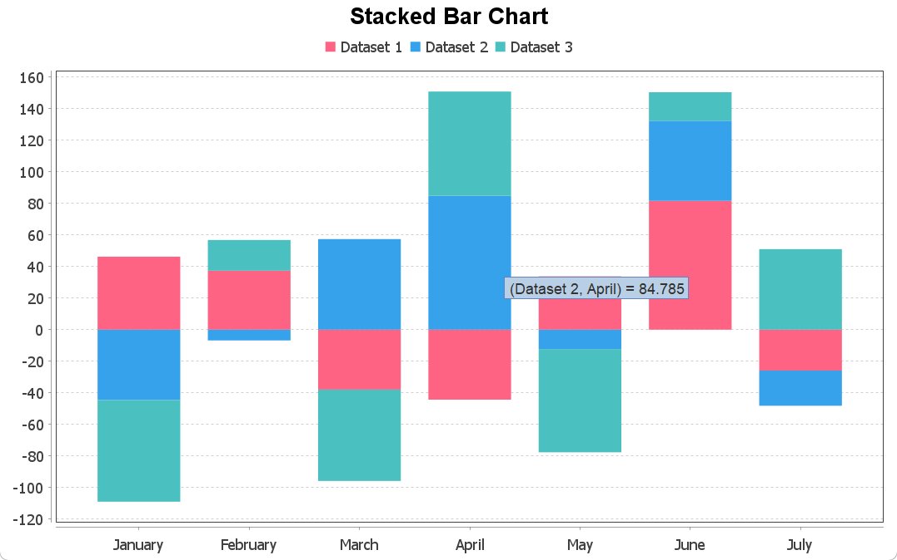
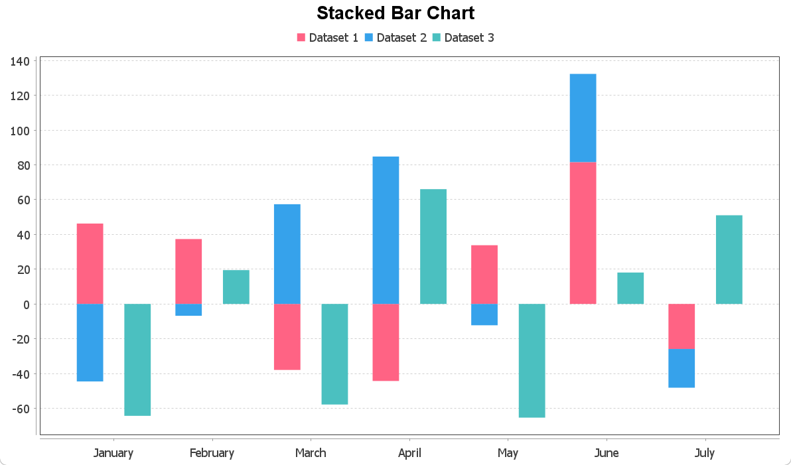

# Bar Charts

## Border Radius

Use `RoundedBarPainter` to draw `BarChart` with rounded corners.

```java
public class BarChartDemo13 {

    private static CategoryBarChart createChart() {
        String[] months = {"January", "February", "March", "April", "May", "June", "July"};
        Random rnd = new Random(42);

        DefaultCategoryDataset<String, String> dataset = new DefaultCategoryDataset<>();
        for (String month : months) {
            dataset.addValue(rnd.nextDouble(201) - 100, "Series 1", month);
            dataset.addValue(rnd.nextDouble(201) - 100, "Series 2", month);
        }

        CategoryBarChart chart = new CategoryBarChart(dataset);
        chart.getLegend().setPosition(RectangleEdge.TOP);
        chart.withDomainGridlinesVisible(true)
                .withRangeGridlinesVisible(true);

        final Color RED = new Color(255, 99, 132);
        final Color BLUE = new Color(54, 162, 235);

        chart.getRenderer()
                .withBarPainter(new RoundedBarPainter(true))
                .withItemMargin(0.05)
                .withShadowVisible(false)
                .withDrawBarOutline(true)
                .withSeriesPaint(0, PaintUtils.withAlpha(RED, 0.5f))
                .withSeriesOutlinePaint(0, RED)
                .withSeriesOutlineStroke(0, new BasicStroke(2f))
                .withSeriesPaint(1, PaintUtils.withAlpha(BLUE, 0.5f))
                .withSeriesOutlinePaint(1, BLUE)
                .withSeriesOutlineStroke(1, new BasicStroke(2f))
                .withDefaultLegendShape(new Rectangle2D.Double(-8, -5, 25, 12));

        return chart;
    }

    static void main() {
        createChart().show();
    }
}
```



## Floating Bars

```java
import pdk.chart.CategoryIntervalBarChart;
import pdk.chart.Chart;
import pdk.chart.api.RectangleEdge;
import pdk.chart.color.JColorQualitative;
import pdk.chart.data.category.IntervalCategoryDataset;
import pdk.chart.data.general.DatasetUtils;
import pdk.chart.plot.PlotOrientation;
import pdk.chart.swing.ChartPanel;

import javax.swing.*;
import java.awt.*;
import java.util.Random;

public class BarChartDemo14 {

    private static Chart createChart() {
        String[] labels = DatasetUtils.months(7);
        int n = labels.length;

        Random rand = new Random(42);
        double[] starts1 = new double[n];
        double[] ends1 = new double[n];
        double[] starts2 = new double[n];
        double[] ends2 = new double[n];

        for (int i = 0; i < n; i++) {
            double a = rand.nextInt(201) - 100;
            double b = rand.nextInt(201) - 100;

            starts1[i] = Math.min(a, b);
            ends1[i] = Math.max(a, b);

            a = rand.nextInt(201) - 100;
            b = rand.nextInt(201) - 100;
            starts2[i] = Math.min(a, b);
            ends2[i] = Math.max(a, b);
        }

        IntervalCategoryDataset<String, String> dataset =
                DatasetUtils.<String, String>intervalCategory()
                        .addSeries("Dataset 1", starts1, ends1)
                        .addSeries("Dataset 2", starts2, ends2)
                        .categories(labels)
                        .build();

        CategoryIntervalBarChart chart = new CategoryIntervalBarChart(dataset,
                "Month", "Value", "Floating Bar Chart",
                PlotOrientation.VERTICAL, true, true, false);

        Color[] colors = JColorQualitative.ChartJS();

        chart.setSeriesPaint(0, colors[0]);
        chart.setSeriesPaint(1, colors[1]);
        chart.getLegend().setPosition(RectangleEdge.TOP);

        return chart;
    }

    static void main() {
        createChart().show();
    }
}

```



## Horizontal BarChart

```java
import pdk.chart.CategoryBarChart;
import pdk.chart.api.RectangleEdge;
import pdk.chart.axis.AxisLocation;
import pdk.chart.color.JColorQualitative;
import pdk.chart.data.category.DefaultCategoryDataset;
import pdk.chart.data.general.DatasetUtils;
import pdk.chart.plot.PlotOrientation;
import pdk.chart.swing.ChartPanel;
import pdk.chart.util.PaintUtils;

import javax.swing.*;
import java.awt.*;
import java.util.Random;

public class BarChartDemo15 {

    public static CategoryBarChart createChart() {

        String[] months = DatasetUtils.months(7);
        int n = months.length;
        Random rand = new Random(42);
        double[] values1 = new double[n];
        double[] values2 = new double[n];
        for (int i = 0; i < n; i++) {
            values1[i] = rand.nextInt(201) - 100;
            values2[i] = rand.nextInt(201) - 100;
        }

        DefaultCategoryDataset<String, String> dataset = DatasetUtils.<String, String>category(months)
                .addSeries("Dataset 1", values1)
                .addSeries("Dataset 2", values2)
                .build();

        Color[] colors = JColorQualitative.ChartJS();
        Color fillRed = PaintUtils.withAlpha(colors[0], 0.5f);
        Color fillBlue = PaintUtils.withAlpha(colors[1], 0.5f);

        CategoryBarChart chart = new CategoryBarChart(dataset, PlotOrientation.HORIZONTAL);
        chart.setRangeAxisLocation(AxisLocation.BOTTOM_OR_RIGHT);
        chart.setLegendPosition(RectangleEdge.RIGHT);
        chart.getRenderer()
                .withSeriesPaint(0, fillRed)
                .withSeriesOutlinePaint(0, colors[0])
                .withSeriesOutlineStroke(0, new BasicStroke(2f))
                .withDrawBarOutline(true)
                .withSeriesPaint(1, fillBlue)
                .withSeriesOutlinePaint(1, colors[1])
                .withSeriesOutlineStroke(1, new BasicStroke(2f))
                .withDrawBarOutline(true);
        chart.setTitle("Horizontal Bar Chart");

        return chart;
    }

    static void main() {
        createChart().show();
    }
}
```



## Stacked BarChart

```java
import pdk.chart.CategoryBarChart;
import pdk.chart.CategoryStackedBarChart;
import pdk.chart.api.RectangleEdge;
import pdk.chart.color.JColorQualitative;
import pdk.chart.data.category.DefaultCategoryDataset;
import pdk.chart.data.general.DatasetUtils;
import pdk.chart.swing.ChartPanel;

import javax.swing.*;
import java.awt.*;
import java.util.Random;

public class BarChartDemo16 {

    public static CategoryBarChart createChart() {
        String[] months = DatasetUtils.months(7);
        Color[] colors = JColorQualitative.ChartJS();

        Random random = new Random(42);
        String[] series = {"Dataset 1", "Dataset 2", "Dataset 3"};

        DatasetUtils.CategoryDatasetBuilder<String, String> dsBuilder = DatasetUtils.category(months);
        int n = months.length;
        for (String s : series) {
            double[] values = new double[n];
            for (int i = 0; i < n; i++) {
                double value = random.nextDouble(201) - 100;
                values[i] = value;
            }
            dsBuilder.addSeries(s, values);
        }
        DefaultCategoryDataset<String, String> dataset = dsBuilder.build();

        CategoryStackedBarChart chart = new CategoryStackedBarChart(dataset);
        chart.setTitle("Stacked Bar Chart");
        chart.getLegend().setPosition(RectangleEdge.TOP);
        chart.getRenderer()
                .withSeriesPaint(0, colors[0])
                .withSeriesPaint(1, colors[1])
                .withSeriesPaint(2, colors[2]);
        return chart;
    }

    public static JPanel createDemoPanel() {
        return new ChartPanel(createChart());
    }

    static void main() {
        createChart().show();
    }
}
```



## Stacked BarChart with Groups

Group stacked BarChart is achieved with `StackedBarRenderer` plus a `KeyToGroupMap` that assigns each series to a named stack.

The default constructor of `KeyToGroupMap` create a default group implicitly. We should always set the default group to a group that actually contains series, and verify with `getGroupCount()`.

```java
import pdk.chart.CategoryBarChart;
import pdk.chart.CategoryStackedBarChart;
import pdk.chart.api.RectangleEdge;
import pdk.chart.color.JColorQualitative;
import pdk.chart.data.KeyToGroupMap;
import pdk.chart.data.category.DefaultCategoryDataset;
import pdk.chart.data.general.DatasetUtils;
import pdk.chart.swing.ChartPanel;

import javax.swing.*;
import java.awt.*;
import java.util.Random;

public class BarChartDemo17 {

    public static CategoryBarChart createChart() {
        String[] months = DatasetUtils.months(7);
        Color[] colors = JColorQualitative.ChartJS();

        Random random = new Random(42);
        String[] series = {"Dataset 1", "Dataset 2", "Dataset 3"};
        DatasetUtils.CategoryDatasetBuilder<String, String> dsBuilder = DatasetUtils.category(months);
        int n = months.length;
        for (String s : series) {
            double[] values = new double[n];
            for (int i = 0; i < n; i++) {
                values[i] = random.nextDouble(201) - 100;
            }
            dsBuilder.addSeries(s, values);
        }
        DefaultCategoryDataset<String, String> dataset = dsBuilder.build();

        KeyToGroupMap<String, String> groupMap = new KeyToGroupMap<>("Stack 0");
        groupMap.mapKeyToGroup("Dataset 1", "Stack 0");
        groupMap.mapKeyToGroup("Dataset 2", "Stack 0");
        groupMap.mapKeyToGroup("Dataset 3", "Stack 1");

        CategoryStackedBarChart chart = new CategoryStackedBarChart(dataset);
        chart.setTitle("Stacked Bar Chart");
        chart.getLegend().setPosition(RectangleEdge.TOP);
        chart.getRenderer()
                .withSeriesToGroupMap(groupMap)
                .withSeriesPaint(0, colors[0])
                .withSeriesPaint(1, colors[1])
                .withSeriesPaint(2, colors[2]);
        return chart;
    }

    public static JPanel createDemoPanel() {
        return new ChartPanel(createChart());
    }

    static void main() {
        createChart().show();
    }
}
```

