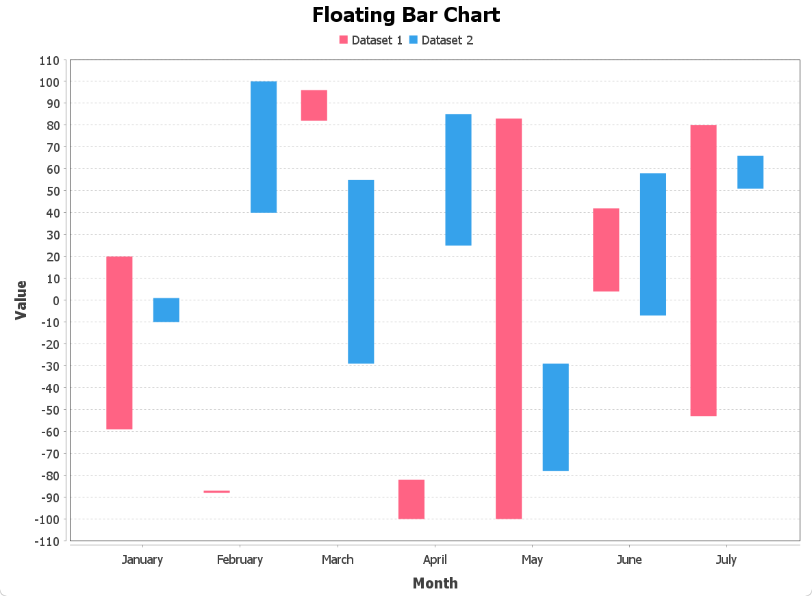

# Bar Charts

## Border Radius

Use `RoundedBarPainter` to draw `BarChart` with rounded corners.

```java
public class BarChartDemo13 {

    private static CategoryBarChart createChart() {
        String[] months = {"January", "February", "March", "April", "May", "June", "July"};
        Random rnd = new Random(42);

        DefaultCategoryDataset<String, String> dataset = new DefaultCategoryDataset<>();
        for (String month : months) {
            dataset.addValue(rnd.nextDouble(201) - 100, "Series 1", month);
            dataset.addValue(rnd.nextDouble(201) - 100, "Series 2", month);
        }

        CategoryBarChart chart = new CategoryBarChart(dataset);
        chart.getLegend().setPosition(RectangleEdge.TOP);
        chart.withDomainGridlinesVisible(true)
                .withRangeGridlinesVisible(true);

        final Color RED = new Color(255, 99, 132);
        final Color BLUE = new Color(54, 162, 235);

        chart.getRenderer()
                .withBarPainter(new RoundedBarPainter(true))
                .withItemMargin(0.05)
                .withShadowVisible(false)
                .withDrawBarOutline(true)
                .withSeriesPaint(0, PaintUtils.withAlpha(RED, 0.5f))
                .withSeriesOutlinePaint(0, RED)
                .withSeriesOutlineStroke(0, new BasicStroke(2f))
                .withSeriesPaint(1, PaintUtils.withAlpha(BLUE, 0.5f))
                .withSeriesOutlinePaint(1, BLUE)
                .withSeriesOutlineStroke(1, new BasicStroke(2f))
                .withDefaultLegendShape(new Rectangle2D.Double(-8, -5, 25, 12));

        return chart;
    }

    static void main() {
        createChart().show();
    }
}
```


### Floating Bars


```java
import pdk.chart.CategoryIntervalBarChart;
import pdk.chart.Chart;
import pdk.chart.api.RectangleEdge;
import pdk.chart.color.JColorQualitative;
import pdk.chart.data.category.IntervalCategoryDataset;
import pdk.chart.data.general.DatasetUtils;
import pdk.chart.model.Data;
import pdk.chart.plot.PlotOrientation;
import pdk.chart.swing.ChartPanel;

import javax.swing.*;
import java.awt.*;
import java.util.Random;

public class BarChartDemo14 {

    private static Chart createChart() {
        String[] labels = DatasetUtils.months(7);
        int n = labels.length;

        Random rand = new Random(42);
        double[] starts1 = new double[n];
        double[] ends1 = new double[n];
        double[] starts2 = new double[n];
        double[] ends2 = new double[n];

        for (int i = 0; i < n; i++) {
            double a = rand.nextInt(201) - 100;
            double b = rand.nextInt(201) - 100;

            starts1[i] = Math.min(a, b);
            ends1[i] = Math.max(a, b);

            a = rand.nextInt(201) - 100;
            b = rand.nextInt(201) - 100;
            starts2[i] = Math.min(a, b);
            ends2[i] = Math.max(a, b);
        }

        IntervalCategoryDataset<String, String> dataset =
                Data.<String, String>intervalCategory()
                        .addSeries("Dataset 1", starts1, ends1)
                        .addSeries("Dataset 2", starts2, ends2)
                        .categories(labels)
                        .build();

        CategoryIntervalBarChart chart = new CategoryIntervalBarChart(dataset,
                "Month", "Value", "Floating Bar Chart",
                PlotOrientation.VERTICAL, true, true, false);

        Color[] colors = JColorQualitative.ChartJS();

        chart.setSeriesPaint(0, colors[0]);
        chart.setSeriesPaint(1, colors[1]);
        chart.getLegend().setPosition(RectangleEdge.TOP);

        return chart;
    }

    static void main() {
        createChart().show();
    }
}

```

